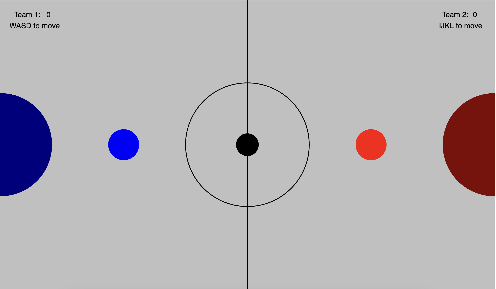
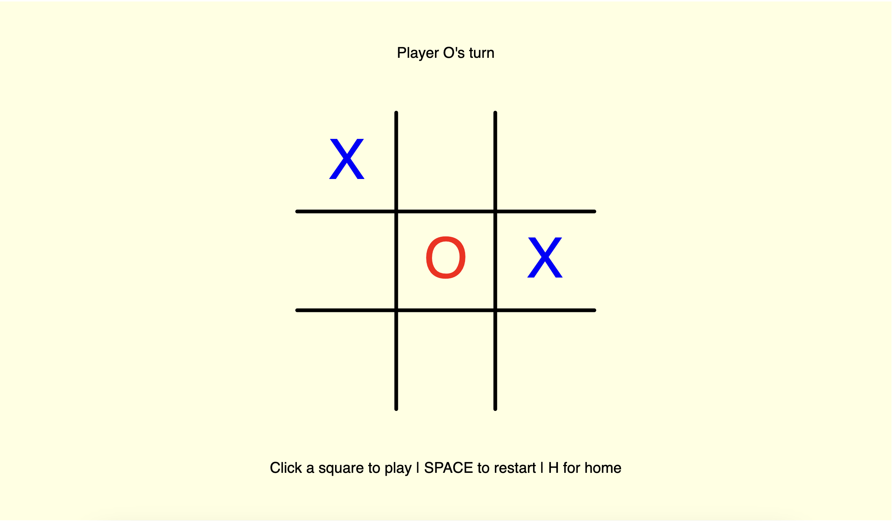

# Ilianna's Final Project {#final-project-top}

## [Project Link](topics/final-project/index.html)

## [Journal 1 - November 19, 2026](#final-journal-1)

## [Journal 2 - November 26, 2026](#final-journal-2)

## [Journal 3 - December 3, 2026](#final-journal-3)

## [Journal 4 - December 10, 2026](#final-journal-4)

---

## Journal Entries

### Journal 1 - November 19, 2026 {#final-journal-1}

This week was the first week of working on the final project for CART 253. For my final project, I decided that I wanted to create a website that features several mini games. My idea is to have a main home page with buttons for each of the mini games. Clicking on a button will take the user to the corresponding game. As of right now, I would like to create five mini games, but if time becomes an issue, my goal is to have at least three completed games by the end of the project.

I want the mini games to be relatively simple and short, with straightforward instructions that make them easy for anyone to understand and play. I have not decided what each mini game will be yet, but I would like them to be different enough from one another so that there is at least one game for everyone to enjoy. I am thinking about using some of my previous prototypes from this class and developing them further, but I would also like to challenge myself by creating some completely new games. I think it would be interesting to have at least one of the mini games be multiplayer in some way, although I have not decided how I would implement this yet.

This week, I focused on creating the main home page with all of the buttons that will eventually lead to the mini games. Everything is currently functional, but the graphics are just placeholders for now and will be updated once I have finished developing the games. I think it might be cool to have each button display a picture representing its mini game, with the title underneath. This would make the home page more visually interesting and give users an idea of what each game is about before clicking on it.

I also decided to reuse one of my previous prototypes from week 7, when we learned about arrays. I really enjoyed making my "Starry Sky" prototype and wanted to develop it further. Originally, the game involved clicking on stars to connect them and create custom constellations. This week, I expanded on the original idea so that players can now create several different constellations that are not connected to one another. I think this adds more possibilities to the game and makes it more interesting for users.

For the remaining mini games, I am considering taking inspiration from some of my other previous prototypes. However, I was also thinking about creating digital versions of classic games, such as TicTacToe or Connect Four. I think these would be fun additions because they are familiar games that most people already know how to play.

So far, I have used several concepts that we learned throughout the semester, including variables, functions, arrays, loops, events, and conditionals. I am glad that I have been able to incorporate almost all of these concepts into my project. However, I would still like to experiment with using them in different ways to continue improving my coding skills.

---

### Journal 2 - November 26, 2026 {#final-journal-2}

Journal Text

---

### Journal 3 - December 3, 2026 {#final-journal-3}

<!-- Journal Text

 -->

---

### Journal 4 - December 10, 2026 {#final-journal-4}

<!-- Journal Text

 -->

---

### [Back to Top](#final-project-top)
